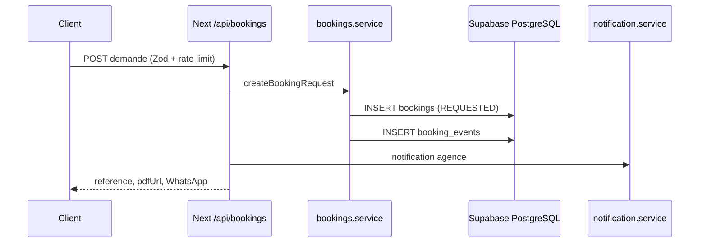

# CarDrive — Architecture (cible production)

## Vue d’ensemble

```
┌──────────────────┐
│    Next.js 16    │
│   Frontend/SEO   │
└────────┬─────────┘
         │
         ▼
┌──────────────────┐
│   Next.js BFF     │
│    /app/api/*     │
└────────┬─────────┘
         │
     ┌───┴───┐
     ▼       ▼
┌─────────┐ ┌──────────────┐
│Supabase │ │ PostgreSQL   │
│Auth/RBAC│ │ Source Truth │
└─────────┘ └──────────────┘
```

- Le navigateur appelle **uniquement** le même origin Next (`API_BASE` vide par défaut dans `frontend/src/lib/api/client.ts`).
- Les route handlers BFF appellent les **services** (`*.service.ts`) qui lisent/écrivent Supabase/PostgreSQL.
- **Express** (`backend/`, port 4000) est **legacy / dev optionnel** si `NEXT_PUBLIC_API_URL` est défini. Le processus refuse désormais de démarrer avec `NODE_ENV=production`.

## Source de vérité des données

| Opération | Chemin canonique | Fallback dev (sans Supabase) |
|-----------|------------------|------------------------------|
| **Lecture** catalogue | `vehicles.service` → Supabase | Store mémoire `frontend/src/lib/services/store.ts` |
| **Lecture** réservations | `bookings.service` → Supabase | Store mémoire |
| **Écriture** demande client | `POST /app/api/bookings` → `bookings.service.createBookingRequest` → Supabase | Store mémoire |
| **Écriture** statut agence | `POST /app/api/bookings/[reference]/status` → Supabase + `booking_events` | Store mémoire |

Les services serveur n’appellent plus Express en premier ; fallback **store mémoire** uniquement sans Supabase.

## Package partagé

`packages/shared` (`@cardrive/shared`) :

- Enums / types : statuts réservation, rôles
- Schémas Zod : `bookingRequestSchema`, actions agence
- Machine à états : `canPerformAgencyBookingAction`, statuts bloquants calendrier

Importé par le frontend Next et le backend Express.

## Auth & rôles

- **Middleware** (`frontend/src/lib/supabase/middleware.ts`) : session Supabase, redirection login, contrôle rôle admin / agence.
- **API BFF** (`frontend/src/lib/auth/server.ts`) : `getServerAuth()`, `canManageAgencyBooking()`, garde sur PATCH statut et commission.
- **RLS** : policies dans `backend/supabase/schema.sql` et migration v2.

Sans variables Supabase, le mode démo ne doit être utilisé qu’en développement ; les gardes de modification/API agence échouent explicitement en production.
`SUPABASE_SERVICE_ROLE_KEY` est exclusivement serveur et nécessaire aux dossiers clients, invitations et limites distribuées.

## Cycle de vie réservation

```
REQUESTED → UNDER_REVIEW → SENT_TO_AGENCY → AGENCY_REVIEW
  → APPROVED | REJECTED | ALTERNATIVE_PROPOSED
  → READY_FOR_PICKUP → ACTIVE → COMPLETED
  (+ CANCELLED, EXPIRED ; legacy PENDING/CONFIRMED normalisés)
```

Chaque transition métier doit journaliser un enregistrement dans `booking_events`.

## Flux booking (client → notification)



## Environnements

| Env | Supabase | mockData / store |
|-----|----------|------------------|
| dev | Projet dev ou local | Autorisé si Supabase absent |
| staging | Projet staging | Interdit |
| prod | Projet prod | **Interdit** |

Seed : `backend/supabase/seed.sql` + `mockData` pour alimenter un projet vierge.

## Santé & CI

- Next : `GET /api/health` (ping `platform_settings` si Supabase configuré)
- Express : `GET /health`
- CI : `.github/workflows/ci.yml` (lint, build shared, tests frontend, builds)
- Limitation de débit production : fonction PostgreSQL `consume_api_rate_limit` via client service-role ; le fallback mémoire est limité au développement.

## Runbook incident (résumé)

| Symptôme | Action |
|----------|--------|
| Double réservation même dates | Vérifier statuts bloquants + contrainte overlap SQL ; lister conflits `bookings` |
| DB down | `/api/health` → 503 ; basculer maintenance ; **ne pas** servir prod sur store mémoire |
| Écart commission UI / DB | Lire `platform_settings.commission_rate` ; admin via `/api/settings/commission` |
