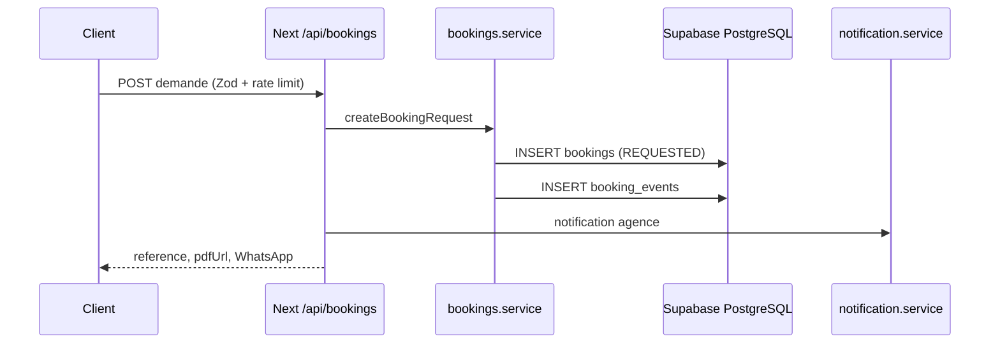

# KlickDrive — Architecture (cible production)

## Vue d’ensemble

```
┌──────────────────┐
│    Next.js 16    │
│   Frontend/SEO   │
└────────┬─────────┘
         │
         ▼
┌──────────────────┐
│   Next.js BFF     │
│    /app/api/*     │
└────────┬─────────┘
         │
     ┌───┴───┐
     ▼       ▼
┌─────────┐ ┌──────────────┐
│Supabase │ │ PostgreSQL   │
│Auth/RBAC│ │ Source Truth │
└─────────┘ └──────────────┘
```

- Le navigateur appelle **uniquement** le même origin Next (`API_BASE` vide par défaut dans `frontend/src/lib/api/client.ts`).
- Les route handlers BFF appellent les **services** (`*.service.ts`) qui lisent/écrivent Supabase/PostgreSQL.
- **Express** (`backend/`, port 4000) est **legacy / dev optionnel** si `NEXT_PUBLIC_API_URL` est défini. Le processus refuse désormais de démarrer avec `NODE_ENV=production`.

## Source de vérité des données

| Opération | Chemin canonique |
|-----------|------------------|
| **Lecture** catalogue public | `public-catalog.service` / `lib/vehicles/public-queries.ts` → Supabase, projection publique (`lib/vehicles/public.ts` : ni plaque, ni n° interne, ni documents) |
| **Lecture** réservations | `bookings.service` → Supabase (RLS) |
| **Disponibilité** | RPC `vehicle_availability()` puis contrôle équivalent sur tables ; 3 états `AVAILABLE` / `UNAVAILABLE` / `UNKNOWN` (`lib/availability/status.ts`) |
| **Écriture** demande client | `POST /app/api/bookings` → `bookings.service.createBookingRequest` → Supabase |
| **Écriture** statut agence | `POST /app/api/bookings/[reference]/status` → Supabase + `booking_events` |

Il n’existe plus de store mémoire ni de données simulées : sans variables Supabase, les services lèvent une erreur explicite.

**Disponibilité fail-closed :** toute erreur de vérification donne `UNKNOWN`, la route `/api/vehicles/[ref]/availability`
répond 503 (`Retry-After`) et l’interface bloque la demande avec un bouton « Réessayer ». Une demande n’est jamais créée
sur une disponibilité non vérifiée. La contrainte d’exclusion `no_overlapping_confirmed_bookings` reste le dernier rempart.

## Rendu et SEO

- Fiches véhicule (`app/cars/[slug]/page.tsx`) et agence (`app/agencies/[slug]/layout.tsx`) : composants serveur,
  métadonnées issues des vraies données, JSON-LD (`Car`/`Motorcycle`, `AutoRental`, `BreadcrumbList`) sérialisé par
  `jsonLdScript()`, vraie réponse 404. Lecture dédupliquée par requête via `React.cache()`.
- Ne pas ajouter de `loading.tsx` sur une route qui appelle `notFound()` : le streaming fige le statut 200 (« soft 404 »).
- Images Open Graph / Twitter / Apple générées (`app/opengraph-image.tsx`, `twitter-image.tsx`, `apple-icon.tsx`).
- Zones privées (`/account`, `/agency`, `/admin`, `/login`) : `noindex` en métadonnées et en en-tête `X-Robots-Tag`.

## Dialogues modaux

Tout dialogue modal utilise `useModalDialog` (`frontend/src/lib/a11y/useModalDialog.ts`) : focus initial
(`data-autofocus`, sinon premier champ), Tab piégé, Échap pour le dialogue au premier plan, reste de la page `inert`,
défilement bloqué, focus rendu à l’élément d’ouverture. Le fond cliquable porte `data-modal-backdrop`.

## Langues

- 6 langues : `fr` (défaut), `en`, `es`, `de`, `nl`, `ar` (RTL) — `lib/i18n/config.ts`, dictionnaires `translations/*.ts`.
- La langue est lue **côté serveur** (cookie `klickdrive_locale`, sinon `Accept-Language` dans `proxy.ts`) :
  `lang` et `dir` sont corrects dès le premier HTML, sans bascule après hydratation.
- Une seule URL par page (pas de préfixe de langue) : pas de `hreflang`.

## Package partagé

`packages/shared` (`@klickdrive/shared`) :

- Enums / types : statuts réservation, rôles
- Schémas Zod : `bookingRequestSchema`, actions agence
- Machine à états : `canPerformAgencyBookingAction`, statuts bloquants calendrier

Importé par le frontend Next et le backend Express.

## Auth & rôles

- **Middleware** (`frontend/src/lib/supabase/middleware.ts`, appelé par `proxy.ts`) : session Supabase sur `/account`,
  `/agency` et `/admin` ; `/admin` réservé à `SUPER_ADMIN` ; `/agency` exige un membre actif d’une agence active ;
  redirection de connexion limitée aux chemins internes ; `Cache-Control: private, no-store`.
  En production, l’absence de configuration Supabase donne 503 (fail-closed).
- **API BFF** (`frontend/src/lib/auth/server.ts`) : `getServerAuth()`, `canManageAgencyBooking()`, garde sur PATCH statut et commission.
- **RLS** : policies dans `backend/supabase/schema.sql` et les migrations ; durcissement `20261107000100_security_hardening.sql`.
- **Rôle plateforme :** seul `SUPER_ADMIN` a des droits globaux (`isPlatformAdminRole`, `is_admin()`, `is_super_admin()`).
  Le rôle historique `ADMIN` n’en a plus aucun.
`SUPABASE_SERVICE_ROLE_KEY` est exclusivement serveur et nécessaire aux dossiers clients, invitations et limites distribuées.

## Cycle de vie réservation

```
REQUESTED → UNDER_REVIEW → SENT_TO_AGENCY → AGENCY_REVIEW
  → APPROVED | REJECTED | ALTERNATIVE_PROPOSED
  → READY_FOR_PICKUP → ACTIVE → COMPLETED
  (+ CANCELLED, EXPIRED ; legacy PENDING/CONFIRMED normalisés)
```

Chaque transition métier doit journaliser un enregistrement dans `booking_events`.

## Flux booking (client → notification)



## Environnements

| Env | Supabase | Données simulées |
|-----|----------|------------------|
| dev | Projet dev ou local | Aucune (Supabase requis) |
| staging | Projet staging | Interdit |
| prod | Projet prod | **Interdit** |

Seed : `backend/supabase/seed.sql` pour alimenter un projet vierge.

## Tests

| Commande (dans `frontend/`) | Contenu |
|---|---|
| `npm run test:unit` | Vitest (`src/**/*.spec.ts`) : disponibilité, retries WhatsApp, autorisation, i18n, JSON-LD ; composants (`*.spec.tsx`, jsdom + React Testing Library) : dialogues, carte et modale de réservation, formulaire véhicule |
| `npm run test:e2e:public` | Playwright (bureau + mobile) en lecture seule : découverte, filtres, fiche, espaces privés, arabe RTL, axe-core WCAG 2.2 AA |
| `npm run test:e2e` | + parcours authentifiés (`e2e/staging/`) : uniquement sur staging avec les variables `E2E_*` (voir `e2e/support/env.ts`) |
| `npm run test:db` | Toutes les migrations appliquées sur un vrai PostgreSQL embarqué (PGlite) qui reproduit les rôles Supabase (`anon`, `authenticated`, `service_role`) et `auth.uid()` ; tests RLS multi-utilisateurs (`src/tests/db/`) |
| `npm run test:legacy` | Suites historiques `node:test` |
| `npm run test` | Les trois |

Node ≥ 22.12 est requis (Vitest 5).

## Santé & CI

- Next : `GET /api/health` (ping `platform_settings` si Supabase configuré)
- Express : `GET /health`
- CI : `.github/workflows/ci.yml` — Node 22.12 ; lint, typecheck, tests unitaires, tests base, suites historiques, build ;
  job staging conditionné aux secrets (migrations + E2E, à compléter).
- Limitation de débit production : fonction PostgreSQL `consume_api_rate_limit` via client service-role ; le fallback mémoire est limité au développement.
- Notifications WhatsApp : nouvelles tentatives bornées (429 / 5xx / réseau, jamais après un timeout), échec explicite en
  production si non configuré, numéros masqués dans les journaux.

## Runbook incident (résumé)

| Symptôme | Action |
|----------|--------|
| Double réservation même dates | Vérifier statuts bloquants + contrainte overlap SQL ; lister conflits `bookings` |
| DB down | `/api/health` → 503 ; la disponibilité passe à `UNKNOWN` (aucune demande créée) ; basculer maintenance |
| Clé `service_role` exposée | Désactiver les clés historiques dans Supabase, configurer les nouvelles chez l’hébergeur, redéployer, examiner les journaux (voir `docs/remediation-2026-11.md`) |
| Écart commission UI / DB | Lire `platform_settings.commission_rate` ; admin via `/api/settings/commission` |
