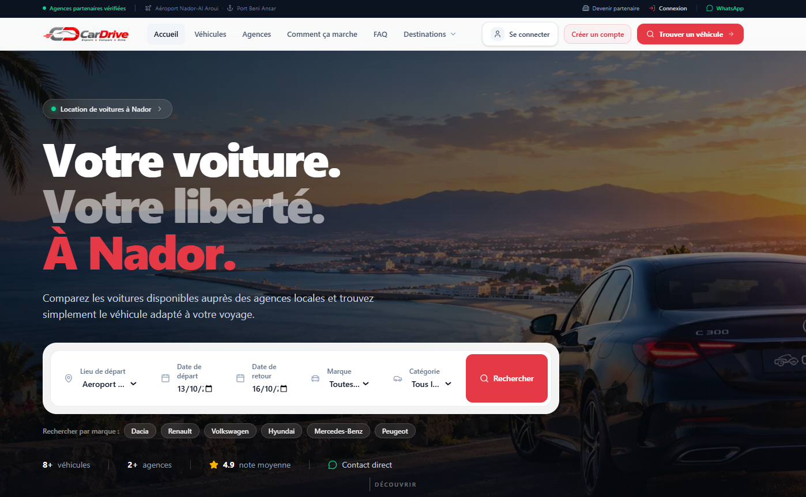
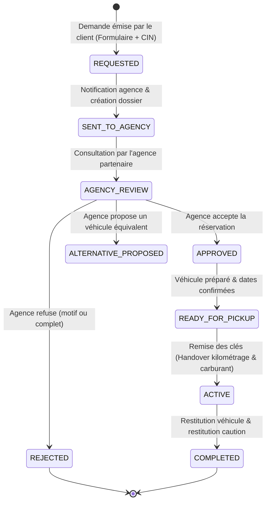

# 🚗 CarDrive — Marketplace de Location de Voitures à Nador

[](https://nextjs.org/)
[](https://www.typescriptlang.org/)
[](https://supabase.com/)
[](https://tailwindcss.com/)
[]()

**CarDrive** est une plateforme SaaS & Marketplace automobile nouvelle génération conçue pour moderniser et sécuriser la location de véhicules à Nador et dans la région de l'Oriental (Aéroport Nador Al-Aroui, Port Beni Ansar, Centre-Ville, Marchica).

Elle connecte les voyageurs et résidents aux agences locales vérifiées avec un système de disponibilité en temps réel, un moteur de réservation avec protection anti double-booking, la génération instantanée de contrats PDF officiels, la transmission automatisée sur WhatsApp et des espaces de gestion complets (Agences & Super-Admin).

---

<p align="center">
  
</p>

<p align="center"><em>Aperçu de la Marketplace CarDrive — Expérience utilisateur moderne, rapide et responsive</em></p>

---

## 🌟 Fonctionnalités Clés

### 🚘 Pour les Voyageurs & Clients
- **Catalogue & Filtres Avancés** : Recherche par dates de prise en charge/restitution, budget journalier (curseur dynamique jusqu'à 5 000+ DH), marques, catégories (Économique, SUV, Luxe, Berline, 7 places, etc.), type de carburant et boîte de vitesses.
- **Disponibilité en Temps Réel** : Badges dynamiques (*« Disponible »* en vert vs *« Non disponible »* en rouge) synchronisés directement avec le calendrier des réservations actives.
- **Demande de Réservation Sécurisée en 4 Étapes** :
  1. Choix du véhicule & des dates précises avec vérification anti-chevauchement.
  2. Saisie des informations conducteur (CIN marocaine ou Passeport, permis de conduire, coordonnées).
  3. Sélection du point de livraison (Aéroport Nador Al-Aroui NDR, Port Beni Ansar, Centre-ville, Agence locale) et options (siège bébé, second conducteur).
  4. Récapitulatif tarifaire transparent (prix journalier, caution, durée totale, montant de garantie).
- **Génération Instantanée de PDF Officiel** : Téléchargement du bon de réservation complet incluant logo officiel, références uniques (`CD-YYYY-XXXXXX`), coordonnées complètes et modalités de remise.
- **Dispatch WhatsApp Automatisé** : Redirection directe en un clic vers l'agence avec message pré-formaté et référence du dossier.

### 🏢 Pour les Agences Partenaires (Dashboard Agence)
- **Gestion de Flotte Automobile** : Ajout, édition, désactivation et suivi du statut des véhicules (`AVAILABLE`, `RENTED`, `MAINTENANCE`, `BLOCKED`).
- **Calendrier & Validation des Demandes** : Approbation en 1 clic (bascule instantanée du véhicule sur *« RENTED »*), rejet avec motif ou proposition de véhicule équivalent de remplacement.
- **Processus de Remise des Clés & Restitution (Handover)** : État des lieux digitalisé avec saisie du kilométrage départ/retour, niveau de carburant, restitution de caution et notes d'inspection.
- **Badge « Agence Vérifiée »** : Audit et certification de conformité pour inspirer confiance aux touristes et MRE.

### 🛡️ Pour les Administrateurs Plateforme (Super-Admin)
- **Supervision Complète de la Marketplace** : Vue d'ensemble des volumes de réservations, chiffre d'affaires généré et santé du système.
- **Modération & Agrément des Agences** : Validation des nouvelles agences candidates, révocation ou suspension immédiate.
- **Gestion Financière des Commissions** : Taux de commission plateforme paramétrable (ex: 15%), suivi des montants dus/collectés et historique de facturation.
- **Audit & Journaux d'Événements** : Traçabilité totale de chaque action (`booking_events`) avec rôle de l'acteur et horodatage.

---

## 🏗️ Architecture Technique (Monorepo)

Le projet est structuré sous forme de monorepo moderne géré par `npm workspaces` :

```
CarDrive/
├── frontend/                     # Application principale Next.js 16 (App Router)
│   ├── public/                   # Images des véhicules, logos, visuels des lieux
│   ├── src/
│   │   ├── app/                  # Routes applicatives & Route Handlers BFF (/api/*)
│   │   │   ├── (seo)/[seoSlug]/  # Landing pages SEO ultra-rapides
│   │   │   ├── account/          # Espace compte client & suivi réservations
│   │   │   ├── admin/            # Dashboard Super-Admin (Overview, Flotte, Agences, Audit)
│   │   │   ├── agency/           # Dashboard Agence (Flotte, Réservations, Handover)
│   │   │   ├── api/              # Backend For Frontend (BFF) & endpoints Next.js
│   │   │   ├── cars/[slug]/      # Fiche technique & galerie complète du véhicule
│   │   │   └── search/           # Moteur de recherche & filtres multi-critères
│   │   ├── components/           # Composants UI modulaires (Tailwind, Framer Motion)
│   │   │   ├── admin/            # Vues et composants d'administration
│   │   │   ├── agency/           # Vues de gestion d'agence & remise des clés
│   │   │   ├── booking/          # Modales de réservation & formulaires CIN
│   │   │   ├── cars/             # Cartes véhicules, galeries, alternatives similaires
│   │   │   └── shared/           # Navigation, pied de page, badges et alertes
│   │   ├── lib/                  # Logique métier, clients Supabase, services serveur
│   │   │   ├── availability/     # Moteur de calcul de chevauchement de dates
│   │   │   ├── services/         # Services backend (vehicles, bookings, pdf, stats)
│   │   │   └── supabase/         # Clients SSR, Service Role & Middleware de session
│   │   └── types/                # Déclarations TypeScript
│   ├── .env.local                # Configuration locale frontend
│   └── package.json
│
├── packages/shared/              # Package partagé @cardrive/shared
│   ├── src/
│   │   ├── booking-status.ts     # Statuts canoniques, statuts bloquants & transitions
│   │   ├── permissions.ts        # RBAC & permissions (AGENCY_OWNER, STAFF, SUPER_ADMIN)
│   │   └── schemas/              # Schémas de validation Zod partagés
│   └── package.json
│
├── backend/                      # Backend Express legacy & scripts d'infrastructure
│   └── supabase/                 # Schémas SQL, migrations PostgreSQL & tests de performance
│       ├── schema.sql            # Schéma DDL complet avec tables & RLS
│       └── migrations/           # Migrations de disponibilité dynamique & idempotence
│
└── package.json                  # Racines des workspaces et scripts globaux
```

---

## 🔄 Flux & Cycle de Vie des Réservations



### Protection Anti-Double-Booking
Le système s'appuie sur une fonction PostgreSQL dédiée (`vehicle_availability`) et une validation Zod stricte :
- Détection instantanée des chevauchements de plages de dates (`daterange &&`).
- Prise en compte immédiate des statuts bloquants : `APPROVED`, `CONFIRMED`, `ACTIVE`, `READY_FOR_PICKUP`.
- Exclusion des véhicules indisponibles dès la sélection des dates de location.

---

## 🛠️ Stack Technologique

| Domaine | Technologies |
|---|---|
| **Frontend** | [Next.js 16](https://nextjs.org/) (App Router), [React 19](https://react.dev/), [TypeScript 5](https://www.typescriptlang.org/) |
| **Styling & UI** | [Tailwind CSS](https://tailwindcss.com/), [Framer Motion](https://www.framer.com/motion/), [Lucide React](https://lucide.dev/) |
| **Base de Données** | [PostgreSQL](https://www.postgresql.org/) via [Supabase](https://supabase.com/) (RLS, Triggers, RPCs) |
| **Authentification** | Supabase Auth (Sessions JWT sécurisées, RBAC multi-niveaux) |
| **Validation** | [Zod](https://zod.dev/) (Schémas typés partagés) |
| **Génération Documents** | [jsPDF](https://github.com/parallax/jsPDF) & [pdf-lib](https://pdf-lib.js.org/) (Bons de réservation officiels) |
| **Sécurité & Performance** | Rate-limiting distribué PostgreSQL, Idempotence des requêtes, Protection anti-désintermédiation |

---

## 🚀 Démarrage Rapide

### Prérequis
- [Node.js](https://nodejs.org/) version 20.x ou supérieure
- [npm](https://www.npmjs.com/) version 10.x ou supérieure
- Une instance PostgreSQL / projet Supabase actif

### 1. Cloner le Répertoire
```bash
git clone https://github.com/azizi-youssef/CarDrive.git
cd CarDrive
```

### 2. Installer les Dépendances du Monorepo
```bash
npm install
```

### 3. Configurer les Variables d'Environnement
Dans `frontend/.env.local` :
```env
# Supabase Configuration
NEXT_PUBLIC_SUPABASE_URL=https://votre-projet.supabase.co
NEXT_PUBLIC_SUPABASE_ANON_KEY=votre_anon_key

# Service Role (Utilisé exclusivement côté serveur)
SUPABASE_SERVICE_ROLE_KEY=votre_service_role_key

# Paramètres applicatifs
NEXT_PUBLIC_APP_URL=http://localhost:3000
```

### 4. Lancer le Projet en Mode Développement
```bash
# Lance le frontend Next.js en développement (Turbopack)
npm run dev -w frontend

# Ou lancer l'ensemble via le script racine
npm run dev
```

L'application est accessible sur : **`http://localhost:3000`**

---

## 📜 Scripts Disponibles

| Commande | Description |
|---|---|
| `npm run dev` | Démarre les serveurs de développement en parallèle |
| `npm run dev:frontend` | Lance uniquement le frontend Next.js (`localhost:3000`) |
| `npm run build` | Compile le package partagé et l'application Next.js pour la production |
| `npm run lint` | Exécute la vérification ESLint sur l'ensemble du monorepo |
| `npm run test` | Lance la suite de tests automatisés (pricing, dates, booking engine) |

---

## 🔒 Sécurité et Protection de la Plateforme

1. **Protection Anti-Désintermédiation** : Les numéros de téléphone et coordonnées directes des agences partenaires sont masqués sur le catalogue public afin de protéger le modèle économique de la marketplace et garantir les réservations via la plateforme.
2. **Idempotence des Réservations** : Chaque soumission de formulaire génère un hash d'empreinte unique (`idempotency_fingerprint`) pour prévenir les doubles débits ou réservations dupliquées lors d'un double-clic ou d'une perte réseau.
3. **Limitation de Débit (Rate Limiting)** : Protection intégrée au niveau de la base de données (`consume_api_rate_limit`) contre les attaques par force brute ou requêtes abusives sur les formulaires sensibles.
4. **Row Level Security (RLS)** : Cloisonnement strict des données entre agences : chaque agence ne peut lire ou modifier que ses propres véhicules et dossiers de réservation.

---

## 👥 Auteur & Contribution

Développé par **[Youssef Azizi](https://github.com/azizi-youssef)** — CarDrive.
Pour toute question, partenariat agence ou signalement de bug, n'hésitez pas à ouvrir une issue ou à contacter l'équipe support locale à Nador.
